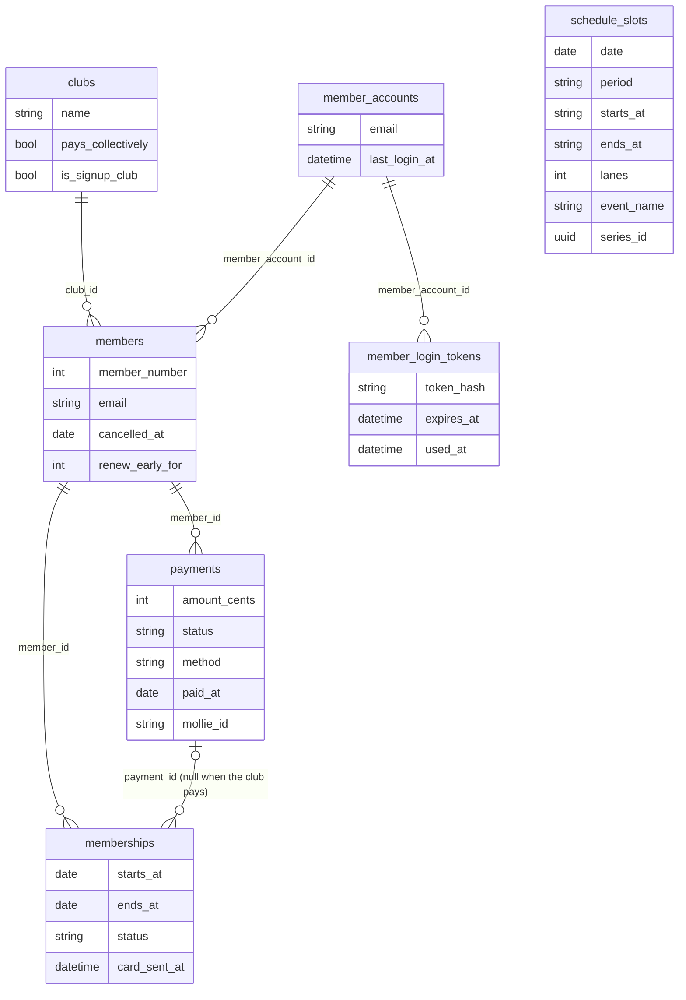

# Data model

How the data of the member administration is organised: what each table holds, how tables relate, and which rules keep the data correct. Types and constraints are in the migrations (`database/migrations`); this document explains what the data *means*.

All dates are shown to users as `dd-mm-jjjj`; amounts are stored as **integer cents** (`9000` = € 90,00). SQLite stores `date` columns as `Y-m-d 00:00:00`, so compare dates with `whereDate()`, never with `where()`.

## Overview

Stand-alone tables (no foreign keys): `users`, `settings`, `joining_rates`, `mail_templates`, `card_year_styles`, `activity_log`.

The tables fall into six areas:

1. [Members and clubs](#members-and-clubs): `members`, `clubs`
2. [Memberships and payments](#memberships-and-payments): `memberships`, `payments`
3. [Logins](#logins): `users` (staff), `member_accounts` and `member_login_tokens` (members)
4. [Rooster](#rooster): `schedule_slots`
5. [Settings, rates and texts](#settings-rates-and-texts): `settings`, `joining_rates`, `mail_templates`, `card_year_styles`
6. [Activity log](#activity-log): `activity_log`

---

## Members and clubs

### `members` — a person who is or was a member

One row per person, kept for life: members are never deleted, only cancelled (`MemberPolicy::delete` returns false).

| Column | Meaning |
|---|---|
| `member_number` | Permanent number, unique, never reused or changed. Shown as `SBM-0261-91` (prefix, four digits, MOD 97-10 check digits; `App\Support\MemberNumber`, `$member->display_number`). The **plain number** is what the QR code on cards signs, so it must never change. New members get the highest number + 1 (`Member::booted`). |
| `first_name`, `middle_name`, `last_name` | Name (on the public sign-up form only letters, spaces, hyphens, apostrophes and dots; in e-mails names are Markdown-escaped, `App\Support\Markdown`); `middle_name` is the Dutch *tussenvoegsel* ("van der"). `$member->full_name` joins them. The QR code carries the name as printed and its signature covers that name, so a name change does not invalidate cards already sent — but they keep showing the old name until a new card is sent. |
| `email` | Contact address and the login of the ledenportaal. Optional (members without e-mail are handled by staff), and **not unique**: two members (a couple) may share one. |
| `phone_mobile`, `phone_home`, `street`, `postal_code`, `city`, `country` | Contact details. Postal codes are strings (Belgian codes are plain numbers). Members can change these themselves in the ledenportaal. |
| `birthday` | Optional. |
| `club_id` → `clubs` | The club (*vereniging*) the member belongs to, or null ("Geen"). Decides who pays: see `clubs.pays_collectively`. |
| `contact_for` | Free text: this person is the contact for someone else. |
| `joined_at` | Member since. |
| `cancelled_at` | Date the membership ends after giving notice (may be in the future). See *current vs. former* below. |
| `renew_early_for` | A year: staff moved this member to "Te verlengen" for that year before the renewal window opened (`MoveUpForRenewal`). |
| `member_account_id` → `member_accounts` | The ledenportaal login of this member's e-mail address. Maintained automatically, never edited by hand (see [Logins](#logins)). |
| `notes` | Internal notes for staff. |

**Current vs. former members.** `cancelled_at` null → member. `cancelled_at` today or later → still a member until and including that date (`isCancelled()` true, `hasLeft()` false; scope `current()`). `cancelled_at` in the past → former member (`hasLeft()`, scope `former()`). Members who gave notice get no renewals, and no cards for periods that start after their end date (`QueueMembershipCard::cannotSendReason`).

**Current expiry** is never stored: it is the `ends_at` of the member's latest *active* membership (`$member->paidUntil()`, relation `currentMembership`). `membershipToday()` is the active period running today: that card is shown at the entrance.

### `clubs` — the clubs (*verenigingen*) members belong to

| Column | Meaning |
|---|---|
| `name` | Unique: SBM Halpas, Mosa Petanca, JBC Amby, … |
| `pays_collectively` | The club pays the contribution for its members (Mosa Petanca, JBC Amby). Their members never get an individual payment request; their memberships wait for the club and are activated in bulk (`ActivateClubPaidMembership`). |
| `is_signup_club` | Everyone who signs up through the public form joins this club (SBM Halpas). At most one club has it (`Club::booted` switches the others off). |

Both flags are edited under Beheer → Verenigingen. Deleting a club sets its members' `club_id` to null.

---

## Memberships and payments

Memberships follow the **calendar year**: a period normally runs 1 January – 31 December. A new member's first period runs from the sign-up date to 31 December.

### `memberships` — one period of membership

History is never overwritten: every year is its own row.

| Column | Meaning |
|---|---|
| `member_id` → `members` | Whose membership. |
| `starts_at`, `ends_at` | The period. Unique per member on `starts_at`. The year on the card is the year of `starts_at` (`cardYear()`). |
| `status` | See below. |
| `payment_id` → `payments` | The payment this period is paid with, or **null when the member's club pays**. Several periods can share one payment (below). |
| `card_sent_at` | When the card for this period was last e-mailed. |

**Status** (`App\Enums\MembershipStatus`):

| Status | Meaning | How it gets there |
|---|---|---|
| `pending` | Awaiting payment (by the member, or by the club when `payment_id` is null). | New member, renewal, or added by hand (`AddMembership`). |
| `active` | Paid; the member may play in this period. | Only through a payment (`MarkPaymentPaid`) or, for club-paid periods, `ActivateClubPaidMembership`. Never set by hand. |
| `expired` | Marked as expired by staff. | By hand only (`UpdateMembership`). Nothing sets it automatically. |
| `cancelled` | Withdrawn before it was paid. | `CancelPayment`, `CancelPendingMembership`. |

Whether someone is a valid member on a date is decided by dates, not by status alone: an `active` period whose `starts_at`–`ends_at` contains that date (`isValidOn()`, scope `validOn()`). An `active` 2026 period is not valid in 2027 even if nobody changed its status.

### `payments` — a payment requested from or made by a member

| Column | Meaning |
|---|---|
| `member_id` → `members` | Who pays. |
| `description` | Shown to the member and on the payment page, e.g. "Contributie 2027". |
| `amount_cents` | Amount in cents, fixed when the payment is created (later rate changes don't change it). |
| `status` | `open` (requested), `paid`, `cancelled` (withdrawn), `refunded` (`App\Enums\PaymentStatus`). |
| `method` | How it was paid: `cash`, `bank_transfer` (registered by staff), `ideal`, `bancontact` (through Mollie). Null while open. |
| `paid_at` | Date the money was received (for Mollie: Mollie's payment date). |
| `reference` | Free reference: the Mollie id (`tr_…`) for online payments, "Contant bij de ingang" for cash at the door, or what staff typed. |
| `mollie_id` | The latest Mollie checkout started for this payment. A member who clicks the payment link twice continues the same checkout. |

**One payment, several periods.** A member who signs up in December pays the rest of this year plus next year in one payment: two `memberships` rows point to the same `payment_id`. Marking that payment paid activates both. This deviates from a strict one-to-one model on purpose.

**Paying activates.** `MarkPaymentPaid` is the only path from `open` to `paid`, whether staff click "Markeer als betaald", a member pays through Mollie (`SettleOnlinePayment`), or staff take cash at the entrance (`CollectAtEntrance`). It activates the payment's pending periods, e-mails the payment confirmation and queues the card for the latest period. Payments are never edited or deleted, only cancelled while open.

**Online payments.** Every open payment has a signed public page (`PaymentLink::for($payment)`). Mollie reports only an id to the webhook; the status is always fetched from Mollie, and processing is idempotent (cache lock + status check). Money for a payment that is no longer open, or for a different amount, is logged (`online_payment_unmatched`), never applied automatically.

### Renewals

Not a table, but how the tables above change each year (`RenewMembership`, page Verlengingen):

- A member is **renewable** for a year when they were active the year before, gave no notice and have no non-cancelled period in that year yet (scope `renewable`). Renewing twice creates nothing extra.
- **Due** = renewable and the membership ends within `settings.renewal_window_days` (default 42), or moved up by hand (`renew_early_for`). The rest is "Nog niet aan de beurt".
- Renewing creates a `pending` period 1-1 to 31-12 and, unless the club pays, an `open` payment for the annual fee plus the "Verlenging" e-mail with the payment link. A withdrawn renewal for the same year is reused rather than duplicated (`memberships` is unique on member + start date).

---

## Logins

Staff and members log in separately and never share a table.

### `users` — staff (admin panel, `/admin`)

| Column | Meaning |
|---|---|
| `name`, `email`, `password` | Normal Laravel login. |
| `role` | `admin` (everything), `treasurer` (payments and renewals), `viewer` (read-only) — `App\Enums\UserRole`, enforced by policies. |
| `app_authentication_secret`, `app_authentication_recovery_codes`, `has_email_authentication` | Two-step verification (Filament MFA). Optional unless `ADMIN_MFA_REQUIRED=true`. |

Guard `web`. Staff logged in on a phone also get extra actions on the card check page (`User::loggedInStaff()`).

### `member_accounts` — a member's login for the ledenportaal (main domain)

One row per **e-mail address**, not per member: members sharing an address (a couple) share one login and see each other's memberships. There are no passwords; members log in with a link sent by e-mail. Guard `member`.

| Column | Meaning |
|---|---|
| `email` | The login address, unique, lower case. |
| `remember_token` | "Stay logged in on this device". |
| `last_login_at` | Shown to staff on the member page. |

Accounts are created and linked **automatically** (`LinkMemberAccount`) — never by hand:

- when a member is created (panel or sign-up form), pays (`MarkPaymentPaid`), is activated by their club, or asks for a login link, the current members with that address are linked to the account of that address;
- **but** anyone can sign up with any address: when an address already has an *established* member (one with an active membership, or already on the login), only established members are linked. A new, unpaid sign-up on that address joins the login once its payment comes in. A completely new address gets its login straight away, so new members can log in to pay;
- the one-off import (still to be built) creates active memberships without a payment, so it must call `LinkMemberAccount::forMember()` itself;
- when a member's e-mail address changes: if the member had the account to themselves, the account moves to the new address; otherwise the member moves to the account of the new address;
- members without an e-mail address have no account.

A member who changes their own address in the ledenportaal must first confirm it from the new mailbox (`UpdateContactDetails`, `ConfirmEmailChange`), because the address is the login. Afterwards the **old** address gets a notice (`EmailChangedNoticeMail`), so a change made by someone else (e.g. on an unlocked phone) does not go unnoticed.

### `member_login_tokens` — login links that were e-mailed

| Column | Meaning |
|---|---|
| `member_account_id` → `member_accounts` | Whose link (deleted with the account). |
| `token_hash` | SHA-256 of the token. The token itself is only in the e-mail, never stored. |
| `expires_at` | 30 minutes after sending (`SendLoginLink::VALID_MINUTES`). |
| `used_at` | Set when the link was used: a link works once. |
| `requested_ip` | Who asked for it. |

Expired links are removed daily (`model:prune`). Opening a link only shows a button; the login happens on the button press, so mail scanners that open links cannot use them up.

---

## Rooster

### `schedule_slots` — a part of a day the Boulodrôme is open

**No row means closed.** Rows are only written through `SaveScheduleSlot` (and `ScheduleSeries` for repeated events), which enforces the rules below.

| Column | Meaning |
|---|---|
| `date` | The day. |
| `period` | `afternoon` (Middag), `evening` (Avond) or `custom` (an extra part of the day with its own times) — `App\Enums\SchedulePeriod`. At most one afternoon and one evening per day; any number of custom ones. |
| `starts_at`, `ends_at` | Times as `"HH:MM"` (24-hour). Middag and Avond take the standard times from settings when they are opened and **keep them**: changing the standard times only affects parts of the day opened afterwards. |
| `lanes` | Lanes available, 1 to `config('schedule.lanes')` (16). |
| `event_name` | Set → this part of the day is an event. Null → a normal opening. |
| `event_name_public` | Whether non-staff may see the event name. Default **off**: they see "Evenement" (`publicEventName()` — use it everywhere members or the public look). |
| `event_lanes` | Lanes the event takes; default all open lanes. |
| `remaining_lanes_reservable` | Whether the lanes the event leaves free can be reserved. Default **off** for events (always on for normal openings). |
| `series_id` | Shared by all occurrences of a repeated event (UUID). |

**Rules (in `SaveScheduleSlot`):**

- Parts of a day never overlap (touching is fine): an extra 12:00–14:00 makes a 13:00–17:00 Middag impossible that day, and the other way round.
- The past is fixed: nothing can be opened, changed or closed on an earlier day, or for a part of today that has ended (`hasEnded()`).
- `reservableLanes()` is what reservations will use: all open lanes, or for an event the lanes it leaves free when those may be reserved, otherwise 0.

**Repeated events** (`ScheduleSeries`): every occurrence is its own row with the same `series_id`, weekly or every other week, up to 12 months ahead. Dates that already have an event in that part of the day, or that would overlap, are skipped and reported, never overwritten. Changing one occurrence changes only that date, unless staff choose to apply it to the following ones; an occurrence that stops being an event leaves the series.

---

## Settings, rates and texts

### `settings` — key/value settings staff can change

Values are stored as JSON. Read and write with `Setting::get()` / `Setting::put()`; changes are logged.

| Key | Value | Edited under |
|---|---|---|
| `annual_fee_cents` | Annual fee for renewals, e.g. `9000`. | Beheer → Tarieven |
| `renewal_window_days` | Days before a membership ends that it counts as "Te verlengen" (default 42). | Beheer → Tarieven |
| `bank_iban`, `bank_account_holder` | Bank details for transfers (in e-mails and on the payment page). | Beheer → Tarieven |
| `schedule_afternoon_times`, `schedule_evening_times` | Standard times of Middag and Avond, e.g. `["13:00","17:00"]`. | Beheer → Openingstijden |

### `joining_rates` — what a new member pays, by sign-up date

| Column | Meaning |
|---|---|
| `starts_on` | `MM-DD` from which this rate applies (until the next rate starts). There is always one for `01-01`. |
| `amount_cents` | Amount for the rest of the year. |
| `includes_next_year` | Also charge next year's annual fee in the same payment, with a second membership period (the December rate). |

Used by `App\Services\Fees::quoteForNewMember()`. Editing rates never changes existing payments.

### `mail_templates` — editable e-mail texts

| Column | Meaning |
|---|---|
| `key` | Fixed name used in code: `membership_card`, `welcome` (aanmelding), `payment_confirmation`, `cancellation`, `renewal`. |
| `name` | Name shown to staff. |
| `subject`, `body` | Text with `{placeholders}` (Markdown body). Which placeholders exist per key: `App\Services\MailTemplates`. |

Edited under Beheer → E-mailteksten. Some e-mails can also be adjusted for a single send in their dialog. The login-link and e-mail-confirmation mails are deliberately **not** editable (fixed texts in `lang/nl/portal.php`).

### `card_year_styles` — colours of the year badge on cards

| Column | Meaning |
|---|---|
| `year` | Unique. |
| `badge_color`, `text_color` | Hex colours of the year badge. Years without a row use the accent colour with black text. |

---

## Activity log

### `activity_log` — who changed what, and when (`spatie/laravel-activitylog`)

Shown in the panel as the Logboek; descriptions are made readable by `App\Services\ActivityPresenter` (field names only, never values, so no personal data on the dashboard).

| Column | Meaning |
|---|---|
| `log_name` | Area: `members`, `memberships`, `payments`, `settings`, `schedule`, `accounts`. |
| `event` | What happened: `created`, `updated`, `deleted`, or a domain event such as `paid`, `renewed`, `card_sent`, `mail_sent`, `signed_up`, `repeated`, `logged_in`, `online_payment_unmatched`. |
| `subject_type`, `subject_id` | The record it is about. |
| `causer_type`, `causer_id` | Who did it: a staff `User`, a `MemberAccount` (member in the ledenportaal), or nothing (system, e.g. Mollie webhook). |
| `properties` | Changed fields (`attributes`/`old`) and context (amounts, years, e-mail address used, …). |
| `description` | Dutch description for the log. |

Every state change that matters (payments, renewals, cards and e-mails sent, cancellations, Rooster changes, logins) is logged.

---

## Infrastructure tables

Standard Laravel tables, no domain meaning: `sessions` (logins of staff and members), `cache` and `cache_locks` (also rate limiting and the lock that prevents processing a Mollie payment twice), `jobs`, `job_batches`, `failed_jobs` (queued e-mails; the queue runs from the scheduler every minute), `password_reset_tokens`, `migrations`.
